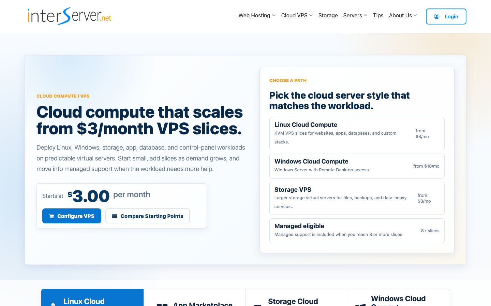
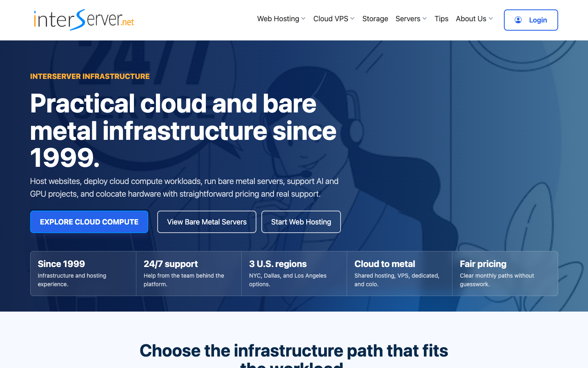
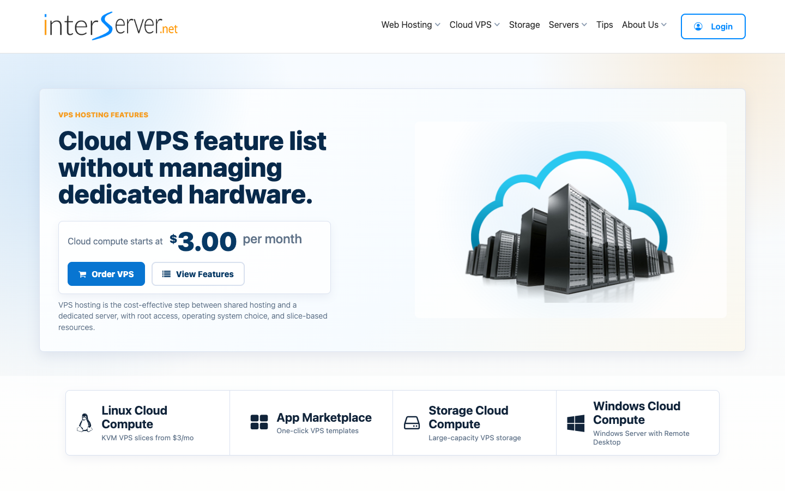

# InterServer VPS 评测 2026：$3/月起的美国云 VPS，按 Slice 灵活扩容

InterServer 是一条很适合替代 Vultr、DigitalOcean 入门小机的美国 VPS 路线：Cloud VPS 从 **$3/月一个 Slice** 起，可以选 Linux、Windows、Storage VPS 和应用型方案。它不是靠短期优惠吸引下单，而是用清楚的月付起点和 Slice 扩容方式，让预算容易控制。

**一句话推荐：需要美国普通线路、月付低门槛和后续平滑扩容，优先看 InterServer。**

适合的使用场景包括海外建站、开发测试、监控、Bot、小型 API、Windows 远程桌面和备份节点。

[查看 InterServer Cloud VPS](https://www.interserver.net/r/1223697)

## InterServer 与 Vultr、DigitalOcean 怎么选？

| 需求 | 更适合的方向 |
|---|---|
| 按小时开关机、丰富云 API 和周边产品 | Vultr / DigitalOcean |
| 一台美国 VPS 长期月付、从低配置开始 | InterServer |
| Linux、Windows、存储型 VPS 在一个商家内选择 | InterServer |
| 需要托管数据库或全球大量区域 | 大型云平台 |

InterServer 的优势是购买逻辑简单：1 Slice 起步，应用增长后增加 Slice；Windows 从更高月费起，Storage VPS 则把预算更多放在容量上。
它的价格结构也更容易理解：先确定产品线，再按 Slice 数量计算月费。

## 一个 Slice 能做什么？

公开页面把 Linux Cloud Compute 的入门价写为 **$3/月**。适合静态站、轻量博客、开发测试、监控、Bot、小型 API 和基础 Linux 环境。

当 WordPress、Docker、数据库或并发进程增加时，可以向上增加 Slice，而不是一开始就购买过大的服务器。页面同时列出：

- Linux Cloud Compute：$3/月起；
- Storage VPS：$3/月起，偏向文件与备份；
- Windows Cloud Compute：$10/月起；
- 8+ Slices 可进入 managed eligible 的产品边界。

这意味着“便宜入门”和“托管能力”不是同一档产品。低配 Slice 更适合能自己维护 Linux 的用户。

## 美国机房与线路怎么理解？

InterServer 公开资料列出纽约、达拉斯、洛杉矶等美国区域。它适合北美用户访问、海外建站、开发环境、备份节点与远程工作负载。

这里更应该按目标访客选美国区域，而不是把普通美国 VPS 包装成特殊回国优化线路。需要国内方向低延迟或特定线路时，应单独选择具备明确线路产品的商家；需要美国性价比时，InterServer 才是重点。

## 控制面板、备份和可用性

InterServer 的 VPS 功能页列有控制面板重装与重启、1 个公网 IP、冗余存储、备份与快照、监控，以及 99.9% uptime commitment。

这些功能更适合长期运行的网站和服务。备份仍应保留一份在服务器之外，不能把同机快照当成唯一数据副本。

## 付款与退款怎么考虑？

InterServer 的公开帮助资料覆盖信用卡与 PayPal 账单管理，具体订单以结账页为准。购买时检查：

1. 当前 Slice 数量与月费；
2. Linux、Windows 或 Storage 产品线；
3. 目标机房是否可选；
4. 备份、快照和额外 IP 的费用；
5. 当前取消与退款适用条件。

月付 VPS 的优势是承诺周期短，但不代表使用后一定无条件退款。最好从最低满足需求的 Slice 数开始，部署完成后再扩容。

## 三种推荐买法

### 轻量 Linux 服务：1 Slice 起步
适合 Nginx、监控、Bot、开发测试和低流量网站。

### WordPress 或 Docker：预留更多资源
先估算面板、数据库和容器本身的内存，再决定 Slice 数，避免只看 $3 的入门数字。

### Windows 远程桌面：直接选 Windows Cloud
Windows 产品从更高月费开始，适合 Windows 软件和远程桌面，不要用 Linux 入门价估算。

[进入 InterServer VPS 购买入口](https://www.interserver.net/r/1223697)

## 最终建议

InterServer 适合想要**美国 VPS、低月付起点、按 Slice 扩容**的用户。轻量 Linux 从 1 Slice 开始；需要 Windows 就直接选 Windows 产品；大量文件与备份看 Storage VPS。它比大型云平台少一些复杂度，也比年付特价机更容易短周期控制预算。

[查看 InterServer VPS 当前配置](https://www.interserver.net/r/1223697)

## FAQ

### InterServer VPS 最低多少钱？
公开 Cloud VPS 页面显示 Linux 与 Storage 路线从 $3/月起。

### InterServer 有 Windows VPS 吗？
有，公开页面显示 Windows Cloud Compute 从 $10/月起。

### InterServer 适合国内访问吗？
它首先是美国普通云 VPS，应按实际运营商和时段测试；不能把美国机房直接等同于回国优化线路。
